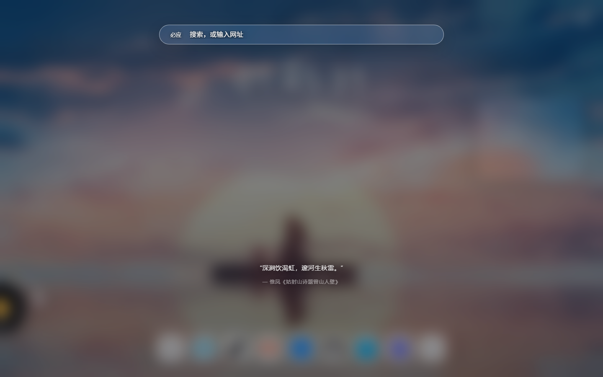

# StartPage · 新标签页

Windows 下自用的浏览器新标签页：搜索、时钟天气、便签、Dock、壁纸，外加**本地多线程下载器**和**音乐小组件**。纯前端 + 一个本地小工具，无服务器、无账号、不收集数据。

  

支持 Edge / Chrome（Manifest V3，版本 ≥ 88）。

---

## 功能

**新标签页**
- 搜索框：多引擎、搜索联想、历史记录；支持 `!前缀` 临时换引擎（详见下方）
- 点搜索框进入聚焦模式：背景全屏虚化，底部显示每日一句（诗词与名言隔天交替，联网取诗词，离线/名言日用本地 60 句）
- 时钟：12/24 小时、日期、农历、节气
- 天气：Open-Meteo，三日预报，可自动定位或手填城市
- 便签：自动保存，右侧垂直居中，可自由拖动
- Dock：图标、拖动排序、右键菜单、悬停放大、磨砂玻璃
- 浏览器书签自动收录：菜单「已添加」顶部一排**分类标签**（收藏夹栏 / vpn / 工具 …），点标签切换该分类下的网站；Dock 快捷方式固定在面板底部
  - 新建/删除收藏后会自动同步（约 0.8 秒）
  - 切回浏览器窗口时也会同步
  - 菜单「已添加」旁有「同步书签」按钮可手动刷新
  - **右键任一菜单项 → 加入 Dock** 即可放到桌面栏
- 全局 Dock：任何网页都能唤出同一排快捷方式——鼠标在屏幕底部停留 0.3 秒，或按 `Alt + J`；显示 2.5 秒后自动收起，滚动/点击页面立刻隐藏
- 壁纸：静态渐变 / 动态渐变 / 图片 / 视频，支持轮播、遮罩、模糊
- 主题：深色浅色自适应，可调强调色、字体、Dock 透明度

**Windows 增强（可选）**
- 多线程下载：浏览器下载交给本地 `PclBridge`，HTTP Range 分段并发（1–64 线程），带进度/暂停/继续
- 音乐组件：屏幕左侧吸一张黑胶唱片，点开有封面、歌名、控制、进度、音量；封面主色会染到卡片
- 播放控制走 Windows 系统媒体会话（SMTC），暂停抬针、播放旋转

---

## 安装（3 步）

1. **解压**发布包（右键 → 全部解压，别在压缩包里直接点开）
2. 地址栏打开 **edge://extensions** → 右下角打开 **开发人员模式**
3. 点 **加载解压缩的扩展** → 选择解压出来、里面能看到 **manifest.json** 的文件夹

新开一个标签页就生效了。

> Chrome 用户把地址换成 **chrome://extensions**，步骤一样。
>
> 想省事：解压后双击 **一键安装.bat**，它会复制文件、生成桌面快捷方式，然后你只需做完上面第 2~3 步。

### 壁纸

**仓库和安装包都不带壁纸/视频**，首次打开是主题渐变，自行配置：

- 设置（右上角齿轮）→ 背景与壁纸 → 选「图片」→ 选择图片
- 或者把图片/视频直接**拖到页面上**
- 或者命名为 **bg.mp4** / **bg.jpg** 放进扩展目录

### 下载器 / 音乐组件（可选）

需要 **PclBridge.exe**（Windows 原生宿主）：

1. 双击解压目录里的 **tools\安装下载器.bat**
2. **完全关闭浏览器**（任务管理器确认没有 msedge.exe），重新打开

验证：地址栏打开 **http://127.0.0.1:6806/ping**，有 JSON 返回即正常。

- 下载器：网页下载自动进扩展面板，支持 1–64 线程分段下载
- 音乐组件：播放器（如 [SPlayer](https://github.com/imsyy/SPlayer)）放歌时，屏幕边缘出现黑胶唱片，点开有封面、控制、进度、音量

卸载注册：**tools\卸载下载器.bat**。

---

## 用法

| 操作 | 效果 |
|---|---|
| **/** | 聚焦搜索框 |
| **Alt + J** | 任意网页唤出全局 Dock（底部停留 0.3 秒也会出现；点图标默认新标签打开） |
| **Alt + M** | 当前页面弹出收藏菜单（浮层，不跳转页面），Esc / 点空白关闭；点收藏默认新标签打开 |
| **1–9** | 打开对应快捷方式 |
| **Esc** | 关闭设置 / 退出搜索框 / 关闭收藏菜单 / 收起全局 Dock |
| **↑ / ↓** | 在搜索联想里上下选择（Enter 打开选中项） |
| **!g** **!b** **!bd** **!z** **!tb** **!gh** | 临时切换搜索引擎 |
| 右键搜索框 | 直接把剪贴板内容粘贴到光标处 |
| 点击搜索框 | 全屏虚化 + 每日一句（联网失败用本地 60 句） |
| 点击唱片 | 展开歌曲卡片；拖唱片可换位置、靠边自动吸附 |

### 搜索前缀怎么用

在搜索框里把前缀写在最前面（`!grust`、`!g rust`、`! g rust`、中文 `！grust` 都行，**只对这一次搜索生效**，不会改掉你设置里的默认引擎）：

| 写法 | 实际去搜 |
|---|---|
| `!ghelectron` / `!gh electron` | 在 GitHub 搜 electron |
| `!b 显卡驱动` | 用 Bing 搜显卡驱动 |
| `!z 耳机推荐` | 用知乎搜耳机推荐 |
| `!tb 机械键盘` | 在淘宝搜机械键盘 |
| `!bd 天气预报` | 用百度搜天气预报 |
| `!g rust 教程` | 用 Google 搜 rust 教程 |

适合“平时用 Bing，偶尔想直接去 GitHub / 淘宝搜一下”的场景：不用进设置改引擎，也不用打开对应网站再点搜索框。

## 设置项说明

设置面板里每一项下面都有一行灰色说明，这里做汇总。

### 背景与壁纸

| 项 | 作用 |
| --- | --- |
| 模式 | 渐变最省电；图片/视频更有氛围 |
| 来源 | 选本地图片/视频，或把 `bg.mp4` / `bg.jpg` 放进扩展文件夹 |
| 当前壁纸 | 显示当前壁纸；读取失败点「存储自检」 |
| 壁纸遮罩 | 黑色蒙层浓度，越高文字越清楚 |
| 壁纸模糊 | 模糊半径，越大越柔和（更耗 GPU） |
| 轮播 | 多图定时切换，间隔越短越费电 |

### 搜索与外观

| 项 | 作用 |
| --- | --- |
| 搜索引擎 | 默认引擎；输入时可用 `!` / `！` 前缀临时切换 |
| 临时切换 | `!g` 谷歌、`!b` 必应、`!bd` 百度、`!z` 知乎、`!tb` 淘宝、`!gh` GitHub |
| 历史条数 | 聚焦时最多显示几条历史，0 关闭 |
| 搜索框样式 / 边框粗细 / 字重 / 颜色 | 搜索框外观 |
| 文字颜色 / 时间颜色 / 边框颜色 | 时钟与文字的配色 |
| 主题 | 深色 / 浅色 / 跟随时间 / 跟随系统 |
| 时钟格式 | 12 或 24 小时制 |
| 字体 / 字重 | 时钟与界面字体、数字粗细 |
| Dock 玻璃 / 玻璃强度 / 玻璃模式 | Dock 与面板的透明与毛玻璃效果 |

### 组件

| 项 | 作用 |
| --- | --- |
| 天气 | 顶部天气组件（Open-Meteo） |
| 时钟 | 中央时钟开关 |
| 便签 | 右侧便签，内容存本机 |
| 便签上沿 | 便签距页面顶部的位置 |
| 显示秒数 | 时钟是否带秒 |
| 正在播放 / 唱片尺寸 | 左下角黑胶与右下角音乐卡片 |

### Dock 与菜单

| 项 | 作用 |
| --- | --- |
| 全局 Dock | 任意网页底部停留唤出 Dock（Alt+J） |
| Dock 行为 | 图标数量、菜单按钮、底部把手 |
| 收藏菜单 | Alt+M 菜单的显示设置 |
| 布局 | 组件自由拖动与位置 |

### 交互 / 性能 / 下载接管

| 项 | 作用 |
| --- | --- |
| 搜索前缀 | 开启 `!b` `!g` 等临时切换引擎 |
| 快捷键 | 页面内快捷键总开关 |
| 后台释放视频内存 | 切走时释放视频解码内存 |
| 拦截浏览器下载 | 把下载交给本机 PclBridge |
| 当前状态 / 线程数 / 保存目录 / 下载通知 | 下载器连接与行为 |
| 接口地址 | 本机下载器地址，默认 `http://127.0.0.1:6806` |

### 快捷方式与数据

| 操作 | 作用 |
| --- | --- |
| ↑ / ↓ 或拖动图标 | 调整 Dock 顺序 |
| 图标 | 手动上传图标图片 |
| →菜单 | 把这条快捷方式加进收藏菜单 |
| 删除 | 只从 Dock 移除，不影响浏览器书签 |
| 添加 | 名称 + 网址；同一站点只保留一条 |
| 从书签栏导入 | 批量导入收藏夹，自动去重 |
| 重新抓取图标 | 重新请求所有站点图标 |
| 导出 / 导入配置 | 备份与恢复设置 |
| 恢复默认 | 清空当前设置 |
### 快捷键

设置 → 快捷键里列出全部按键：浏览器级（Alt+M / Alt+J）可点「修改」跳转 Edge 快捷键页；页面内（`/`、`1–9`、`Esc`、`↑/↓`、`Enter`、`!前缀`）固定，可在「交互」整体开关。

---

## 最近更新

完整记录见 [CHANGELOG.md](CHANGELOG.md)。

| 版本 | 内容 |
|---|---|
| 2.4.70 | 设置项逐条说明、右键粘贴、`！` 全角前缀、快捷键列表 |
| 2.4.19 | 全局 Dock 停留触发、2.5 秒自动收起、滚动/点击即隐藏 |
| 2.4.18 | 便签与音乐组件垂直居中，左右对称 |
| 2.4.17 | 一键安装脚本；安装包不再带壁纸素材 |
| 2.4.15 | 壁纸改 #stage 绘制，切窗不再闪 |
| 2.4.11 | 修复图片壁纸选完变渐变 |

---

## 常见问题

**壁纸变成渐变 / 刷新没了？** 设置 → 背景与壁纸 → 点「存储自检」，把提示内容提 issue。

**切窗时壁纸闪一下？** 现已改为 #stage 背景绘制，旧版才有这个问题。

**音乐组件不显示？** 先确认 **127.0.0.1:6806/ping** 通，且播放器走系统媒体会话（Windows 音量浮窗能看到曲目）。

**下载慢 / 线程不生效？** 服务器需支持 Range；走代理时线程太多反而更慢，建议 16–32。

**更新后？** 扩展管理页点卡片上的「重新加载」。

---

## 引用与致谢

| 资源 | 用途 | 说明 |
|---|---|---|
| [Open-Meteo](https://open-meteo.com/) | 天气 / 城市搜索 | 免费、无需 Key |
| [今日诗词](https://www.jinrishici.com/) | 每日一句 | v1.jinrishici.com |
| Bing / 百度搜索建议 | 搜索联想 | 对应官方接口 |
| [favicon.cccyun.cc](https://favicon.cccyun.cc/) | 站点图标抓取 | 图标版权归各站点 |
| [SPlayer](https://github.com/imsyy/SPlayer) | 测试用播放器 | 无代码依赖，任何支持系统媒体会话的播放器都行 |
| PCL2 | 命名与分段下载思路参考 | 无代码关联 |
| aria2 | 可选下载后端 | 默认用内置 PclBridge |

- 代码为原创，[MIT](LICENSE) 许可；第三方接口各有条款，商业使用请自行确认
- README 截图里的壁纸、插画、封面是**本地个人素材，不在仓库内**，版权归原作者

---

## 开发者

~~~
app.js         核心：搜索 / 壁纸 / Dock / 便签 / 主题 / 设置
extra.js       天气 / 农历 / 音乐组件 / 轮播 / 全局 Dock
background.js  下载拦截 / 原生消息 / 通知
dock.css dock.js  全局浮动 Dock（Shadow DOM 注入）
tools/PclBridge   宿主源码（C# / .NET 8）
~~~

构建宿主：

~~~
cd tools/PclBridge
dotnet publish -c Release -r win-x64 --self-contained false -p:PublishSingleFile=true -o ../../pcl
~~~

宿主本地接口（仅 127.0.0.1:6806）：/ping /status /add /pause|resume|remove /nowplaying /media /cover /volume

---

[MIT](LICENSE)
