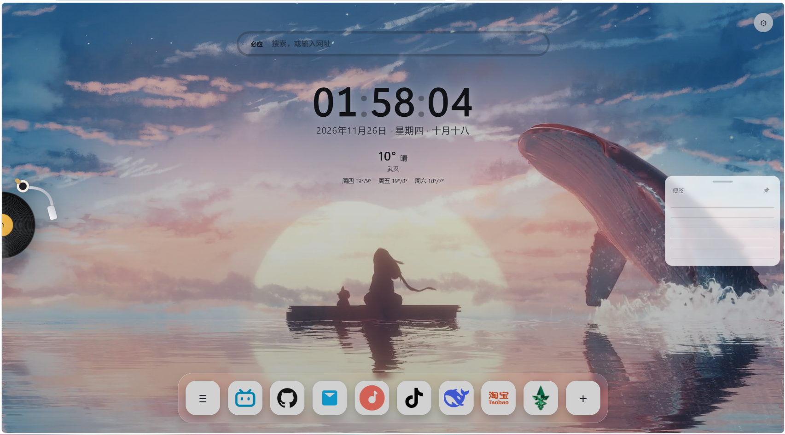

# StartPage · 新标签页

> Windows 下自用的浏览器新标签页扩展：搜索、时钟天气、便签、Dock、壁纸，外加**本地多线程下载接管**和**音乐小组件**。纯前端 + 一个本地 C# 小工具，不需要服务器，不需要账号，不收集任何数据。



<p align="center">
  
</p>

<p align="center">
  <sub>← 左：默认新标签页；右：点击搜索框后的聚焦模式（背景虚化 + 每日一句）</sub>
</p>

---

## 目录

- [零基础安装教程（一步一步跟着做）](#零基础安装教程一步一步跟着做)
- [首次配置（壁纸 / 天气 / Dock）](#首次配置壁纸--天气--dock)
- [使用说明](#使用说明)
- [功能总览](#功能总览)
- [目录结构](#目录结构)
- [数据存储](#数据存储)
- [构建原生宿主](#构建原生宿主)
- [隐私](#隐私)
- [引用与致谢](#引用与致谢)
- [已知限制与常见问题](#已知限制与常见问题)
- [贡献 / License](#贡献--license)

---

## 零基础安装教程（一步一步跟着做）

> 全程大约 3 分钟。**不需要**懂代码，**不需要**管理员权限。
> 如果只想用「新标签页」本身，做完 [第 1 ~ 5 步](#第-1-步下载并解压) 就够了；
> 想用下载器 / 音乐组件，再继续 [第 6 ~ 8 步](#第-6-步可选开启下载器宿主)。

### 第 0 步：确认环境

| 项 | 要求 |
|---|---|
| 浏览器 | Microsoft Edge（推荐）或 Chrome / Chromium，**版本 ≥ 88**（支持 Manifest V3） |
| 系统 | Windows 10 / 11（下载器、音乐组件依赖 Windows；纯前端部分在 macOS/Linux 也可用） |
| 其他 | 无需安装 Node.js、Python、.NET（发布包已带编译好的宿主） |

> 检查 Edge 版本：地址栏输入 `edge://version`，看第一行版本号。

**你应该看到**：地址栏能打开 `edge://version`，版本号 ≥ 88。

---

### 第 1 步：下载并解压

1. 下载发布包 `StartPage-x.y.z.zip`
2. 右键 → **全部解压**（不要直接在压缩包里双击运行，扩展必须从**文件夹**加载）
3. 记住解压后的路径，例如：

```
D:\Tools\StartPage\          ← 这个文件夹里应该能直接看到 manifest.json
```

> ⚠️ 路径里**不要有中文特殊符号问题**一般没事，但建议放在 `D:\Tools\` 这类简单路径下，避免以后移动位置导致扩展失效。

**你应该看到**：解压后的文件夹第一层就有 `manifest.json`、`app.js`、`index.html`。

**如果失败**：
- 双击后只有浏览器打开一堆文件 → 说明你直接打开了压缩包，请先"全部解压"再进文件夹。
- 找不到 `manifest.json` → 你可能多套了一层目录，请进入到**直接包含 manifest.json 的那层**。

---

### 第 2 步：打开扩展管理页

在 Edge 地址栏输入并回车：

```
edge://extensions
```

（Chrome 用户输入 `chrome://extensions`）

**你应该看到**：一个扩展列表页面，左侧/右侧有 **开发人员模式** 的开关。

---

### 第 3 步：打开「开发人员模式」

1. 找到页面右侧（或右上角）的 **开发人员模式 / Developer mode** 开关
2. 点一下打开，开关变成蓝色/高亮

**你应该看到**：页面顶部多出三个按钮：**加载解压缩的扩展**、打包扩展、更新。

**如果失败**：看不到开关 → 你的浏览器可能是被公司策略管控的版本，此时无法加载本地扩展。

---

### 第 4 步：加载扩展文件夹

1. 点 **加载解压缩的扩展**
2. 在弹出的文件夹选择框里，选中**第 1 步解压出来的文件夹**（包含 manifest.json 的那层）
3. 点「选择文件夹」

**你应该看到**：
- 扩展列表里出现一张名为 **新标签页** 的卡片
- 卡片上有一个 32 位 ID（形如 `jbbpipijnhljkkhdbfimmohcdjmlfcnf`）
- 没有红色报错文字

**如果失败**：

| 现象 | 原因 | 解决 |
|---|---|---|
| 提示「清单文件缺失或不可读取」 | 选错了一层目录 | 重新选择**直接含 manifest.json** 的那层 |
| 提示「无法加载扩展，文件名 _xxx 以 _ 开头」 | 文件夹里有以 `_` 开头的子目录/文件 | 删掉或改名后再试 |
| 扩展卡片出现但立刻消失 | 扩展被策略禁用 | 检查浏览器是否为受管控版本 |

---

### 第 5 步：打开新标签页

1. 按 `Ctrl + T` 新开一个标签页（或点标签栏的 `+`）
2. 如果还是默认的 Edge 新标签页，说明被别的扩展抢占了：`edge://extensions` 里关掉其他"新标签页"类扩展

**你应该看到**：

- 中间是大号时钟和日期
- 上方是搜索框
- 底部是 Dock 图标栏
- 右侧是便签

此时**背景是主题渐变**（本仓库不附带壁纸，见下文「首次配置」）。

**如果失败**：
- 页面全白 / 报错 → 回到 `edge://extensions`，看卡片上有没有「错误」按钮，点开把文字提 issue。
- 页面正常但不显示扩展内容 → 可能被其他新标签页扩展覆盖，禁用其他同类扩展。

---

### 第 6 步（可选）：开启下载器宿主

> 只有想用「浏览器下载交给多线程下载器」才需要。不做不影响新标签页。

1. 在解压目录里进入 `tools` 文件夹
2. 双击 **`安装下载器.bat`**
3. 看到窗口输出「已安装: …\pcl\com.pclbridge.bridge.json」和「扩展 ID: …」
4. **完全关闭浏览器**：任务管理器（`Ctrl+Shift+Esc`）里确认没有 `msedge.exe` 残留
5. 重新打开 Edge

**你应该看到**：
- 新标签页 → 设置 → **下载接管** 里状态显示已连接
- 在任意网页点一个下载链接，下载会出现在扩展的下载面板里，而不是浏览器默认下载栏

**验证宿主是否在跑**：浏览器地址栏打开

```
http://127.0.0.1:6806/ping
```

应返回类似：

```json
{"ok":true,"name":"PclBridge","version":"1.2","threads":8,"dir":"D:\\Downloads\\PCL"}
```

**如果失败**：

| 现象 | 解决 |
|---|---|
| 打不开 `127.0.0.1:6806` | 没完全关闭浏览器就重开了；关干净再开，或双击 `tools\安装下载器.bat` 重新注册 |
| 提示端口被占用 | 另一个程序占了 6806，改端口后同步修改扩展设置里的地址 |
| 有下载但很慢 | 见 [常见问题](#已知限制与常见问题) |

> 卸载注册：双击 `tools\卸载下载器.bat`。

---

### 第 7 步（可选）：使用一键安装脚本

如果你不想手动做第 1~6 步，可以使用包里自带的一键脚本：

1. 解压后双击 **`一键安装.bat`**
2. 它会自动：
   - 复制文件到 `%LOCALAPPDATA%\StartPage`
   - 注册下载器宿主
   - 在桌面创建「StartPage」快捷方式（启动时自动带上扩展）
   - 打开 `edge://extensions` 和安装目录
3. 按 [第 3 步](#第-3-步打开开发人员模式) 打开开发人员模式，再按 [第 4 步](#第-4-步加载扩展文件夹) 加载**它弹出的那个目录**
4. 以后从桌面快捷方式启动即可

> 说明：浏览器**不允许**脚本静默安装扩展，所以「加载解压缩」这一次仍需手动点。

---

### 第 8 步（可选）：音乐小组件

1. 确保用支持 Windows 媒体会话的播放器放歌（例如 [SPlayer](https://github.com/imsyy/SPlayer)）
2. 播放时，Windows 音量浮窗（点任务栏音量图标）应能看到当前曲目
3. 回到新标签页：屏幕左边缘会出现一张黑胶唱片
4. 点唱片 → 弹出歌曲卡片；再点空白处收起

**你应该看到**：封面、歌名、歌手、上一首/播放/下一首、进度条、音量。

**如果失败**：
- 唱片不显示 → 先确认 `127.0.0.1:6806/ping` 可用（音乐组件和下载器共用宿主）
- 卡片没内容 → 播放器没有走系统媒体会话（有些播放器需要在设置里开启）

---

## 首次配置（壁纸 / 天气 / Dock）

### 壁纸

> **本仓库不附带任何壁纸或视频素材**（`bg.mp4`、`bg.jpg` 等已在 `.gitignore` 中忽略）。首次打开是主题渐变，需要你自行配置。

三种方式，任选：

1. **设置里选**：设置（右上角齿轮）→ 背景与壁纸 → 模式选「图片」→ 点「选择图片」
2. **拖进来**：直接把图片/视频文件拖到页面上
3. **放目录**：把文件命名为 `bg.mp4` 或 `bg.jpg`，放进扩展文件夹根目录，然后点「用 bg.mp4」/「选择图片」

其他相关设置：

| 设置 | 作用 |
|---|---|
| 壁纸遮罩 | 压暗背景，提升文字可读性 |
| 壁纸模糊 | 背景虚化 |
| 轮播 | 添加多张图，按间隔自动切换 |

**如果壁纸没了 / 变渐变**：设置 → 背景与壁纸 → 点 **存储自检**，按提示内容排查（详见 [FAQ](#已知限制与常见问题)）。

### 天气

1. 设置 → 组件 → 天气 → 打开开关
2. 城市留空则自动定位；定位不准时手动填「武汉」这类城市名
3. 数据来自 [Open-Meteo](https://open-meteo.com/)，无需 Key

### Dock

1. 设置 → 快捷方式与数据 → 添加（名称 + 网址）
2. 也可以从历史记录/菜单里一键加到 Dock
3. 拖动图标可排序，右键图标有菜单

---

## 使用说明

### 快捷键

| 按键 | 作用 |
|---|---|
| `/` | 聚焦搜索框 |
| `Alt + Shift + D` | 唤出/收起全局 Dock（任意网页） |
| `数字 1–9` | 打开对应顺序的快捷方式 |
| `Esc` | 关闭设置面板 / 清空搜索框 |

### 搜索前缀

在搜索框输入 `!g 关键词` 可临时切换引擎：

```
!g   Google      !b   Bing        !bd  百度
!z   知乎        !tb  淘宝        !gh  GitHub
```

### 搜索聚焦

点击搜索框后：页面全屏虚化，只保留搜索框和联想；底部显示一句「每日一句」。

- 联网时从今日诗词接口取当天诗句
- 离线或接口失败时，自动使用内置 60 句按日期轮换
- 同一天内不会变化

### 音乐小组件

| 操作 | 效果 |
|---|---|
| 拖动唱片 | 改位置，靠近边缘自动吸附 |
| 设置 → 组件 → 音乐 | 调大小、开关 |
| 点击唱片 | 展开歌曲卡片 |
| 点击空白 / 移开鼠标 2.5 秒 | 收起卡片 |
| 点进度条 | 跳转播放位置 |
| 底部滑杆 | 调系统主音量 |

### 下载器

- 在网页里触发下载 → 自动进入扩展的下载面板
- 设置 → 下载接管：线程数、保存目录、是否跟随浏览器下载目录
- 线程数建议 16–32（太高反而因代理/服务器限制变慢）

---

## 功能总览

### 新标签页

| 模块 | 说明 |
|---|---|
| 搜索 | 多引擎、搜索联想、历史、`!前缀` |
| 聚焦模式 | 全屏虚化 + 每日一句（联网/离线兜底） |
| 时钟 | 12/24 小时、日期、农历、节气 |
| 天气 | Open-Meteo，三日预报 |
| 便签 | 自动保存、可拖动 |
| Dock | 图标、拖动排序、右键菜单、磨砂玻璃 |
| 全局 Dock | `Alt + Shift + D` 唤出，任意网页可用 |
| 壁纸 | 渐变 / 图片 / 视频 / 轮播 / 遮罩 / 模糊 |
| 主题 | 深色/浅色自适应、强调色、字体、Dock 透明度 |

### 音乐小组件

- 吸附在屏幕边缘的黑胶唱片，可拖动、可调大小
- 卡片：封面、歌名、歌手、专辑、控制、进度、音量
- 暂停抬针、播放旋转；封面主色染到卡片与控件
- 数据来自系统媒体会话（SMTC），不依赖特定播放器

### 下载接管

- HTTP Range 多线程分段下载（1–64 线程）
- 进度/速度/暂停/继续/删除
- 通过 Chrome 原生消息自动拉起，Edge/Chrome/Chromium 通用

---

## 目录结构

```
StartPage/
├─ manifest.json              # MV3 清单
├─ index.html                 # 新标签页结构与内联样式
├─ app.js                     # 核心：搜索/壁纸/Dock/便签/主题/设置
├─ extra.js                   # 扩展功能：天气/农历/音乐组件/轮播/全局 Dock
├─ background.js              # Service Worker：下载拦截、原生消息、通知
├─ dock.css / dock.js         # 全局浮动 Dock（Shadow DOM 注入任意页面）
├─ icon*.png                  # 扩展图标
├─ bg.mp4                     # （可选）视频壁纸，需自行放置，不入库
├─ pcl/
│  ├─ PclBridge.exe           # （构建产物）原生宿主，不入库
│  └─ com.pclbridge.bridge.json  # 安装脚本生成
├─ tools/
│  ├─ setup.ps1               # 一键安装：复制 + 注册 + 快捷方式
│  ├─ install-host.ps1        # 注册原生宿主
│  ├─ install-watch.ps1       # 开机守护（可选）
│  ├─ watch-guard.ps1         # 守护进程
│  ├─ uninstall-host.ps1      # 卸载注册
│  ├─ publish.ps1             # 构建者用：推送到 GitHub
│  └─ PclBridge/              # 宿主源码（C# / .NET 8）
└─ docs/                      # 截图（仅演示）
```

---

## 数据存储

| 数据 | 位置 |
|---|---|
| 设置（壁纸模式、快捷方式、主题等） | `localStorage["startpage.v2"]` |
| 图片/视频壁纸、轮播图 | IndexedDB `startpage` → `assets` |
| 每日一句缓存 | `localStorage["spQuoteDaily2"]` |
| 下载任务 | 宿主内存 + 浏览器下载目录 |

---

## 构建原生宿主

需要 **.NET 8 SDK**（Windows）。

```powershell
cd tools\PclBridge

dotnet publish -c Release -r win-x64 --self-contained false `
  -p:PublishSingleFile=true -o ..\..\pcl
```

产物约 24 MB（含 WinRT 投影）。之后运行 `tools\install-host.ps1` 注册。

### 宿主接口

宿主在 `127.0.0.1:6806` 提供本地 HTTP 接口（仅本机可访问）：

| 接口 | 说明 |
|---|---|
| `GET /ping` | 存活、线程数、下载目录 |
| `GET /status` | 任务列表（进度、速度、线程） |
| `GET /add?url=&name=` | 新建任务 |
| `GET /pause\|resume\|remove?id=` | 任务控制 |
| `GET /nowplaying` | 系统媒体会话信息（歌名/歌手/进度/封面） |
| `GET /media?action=prev\|playpause\|next\|seek&pos=` | 媒体控制（优先 SMTC） |
| `GET /cover` | 当前封面 JPEG |
| `GET /volume` / `?set=0-100` | 读取/设置系统主音量 |

---

## 隐私

- 所有设置与壁纸**只存本机**，不上传任何数据
- 本地宿主只监听 `127.0.0.1`，不对外网开放
- 联网仅限：天气（Open-Meteo）、每日一句（今日诗词）、搜索联想（对应搜索引擎）、图标抓取（favicon 服务）
- 无需登录，无统计上报

---

## 引用与致谢

### 本项目代码

除下列第三方接口与素材外，其余代码（`app.js`、`extra.js`、`background.js`、`dock.js`、`index.html` 及 `tools\PclBridge`）均为原创，采用 [MIT](LICENSE) 许可。

### 使用的第三方服务

| 服务 | 用途 | 调用位置 | 说明 |
|---|---|---|---|
| [Open-Meteo](https://open-meteo.com/) | 天气与城市地理编码 | `extra.js` | 免费、无需 API Key；数据按 CC BY 4.0 提供 |
| [今日诗词](https://www.jinrishici.com/) | 搜索聚焦时的每日一句 | `app.js` | 免费公开接口 `v1.jinrishici.com/all.json` |
| Bing 搜索建议 | 搜索联想 | `app.js` | `api.bing.com/osjson.aspx` |
| 百度搜索建议 | 搜索联想 | `app.js` | `suggestion.baidu.com/su` |
| [favicon.cccyun.cc](https://favicon.cccyun.cc/) | 快捷方式图标抓取 | `app.js` | 第三方图标代理；图标版权归各站点所有 |

> 以上服务有各自的条款与配额限制，本项目仅做客户端调用，不对其可用性与内容负责。Fork 后用于商业场景请自行确认条款。

### 参考与致谢

| 项目 / 资源 | 关系 | 说明 |
|---|---|---|
| [SPlayer](https://github.com/imsyy/SPlayer) | 仅作**测试用播放器**，无代码依赖 | 音乐组件通过 Windows SMTC 读取信息，任何支持 SMTC 的播放器都可用 |
| [.NET 8](https://dotnet.microsoft.com/) / WinRT | 宿主运行时 | `PclBridge` 使用 `Windows.Media.Control` |
| Windows 系统字体 | 界面字体 | 仅用系统自带字体，未打包字体文件 |

### 关于截图中的素材

- README 截图中的**壁纸、动漫插画、音乐封面**均为使用者本地素材，**不包含在本仓库中**，版权归原作者所有，仅作界面效果展示
- 截图中的浏览器图标、站点 Logo 归各自公司所有
- 仓库自带的 `icon16/32/48/128.png` 为本项目图标

### 未使用但被提到的项目

- **PCL2 / PCL 启动器**：`PclBridge` 的命名与「多线程分段下载」思路借鉴自 PCL 的下载体验，本项目与其无代码关联
- **aria2**：设置中保留 aria2 JSON-RPC（默认 `127.0.0.1:6800`）作为**可选下载后端**，默认使用内置 `PclBridge`

---

## 已知限制与常见问题

| 限制 | 说明 |
|---|---|
| 歌词 | 系统媒体会话不提供歌词，需要播放器开远程调试，暂未实现 |
| 一言 API | 部分网络下 `hitokoto.cn` 不可达，故用今日诗词 + 本地 60 句兜底 |
| 多线程内存 | 分段下载每段缓存在内存，文件越大峰值越高；建议线程数 16–32 |
| 平台 | 音乐组件/下载器依赖 Windows；纯前端部分在 macOS/Linux 的 Chrome 也可用 |
| 浏览器限制 | 不允许脚本静默安装扩展，「加载解压缩」需手动一次 |

**Q：壁纸变成渐变 / 刷新后消失？**
A：多为 IndexedDB 版本冲突或存储配额问题。现版本已做自动升版 + Blob 存储 + 失败重试。仍异常时：设置 → 背景与壁纸 → **存储自检**，把提示内容提 issue。

**Q：切换窗口时壁纸闪一下？**
A：旧版用 `` 显示，切窗会重新解码；现改为 `#stage` 的 `background-image` 绘制。

**Q：音乐组件不显示？**
A：确认 `127.0.0.1:6806/ping` 有返回，且播放器走系统媒体会话（Windows 音量浮窗能看到曲目）。

**Q：下载很慢 / 线程数不生效？**
A：看 `/ping` 返回的 `threads`；需要服务器支持 Range，否则回退单流。走代理时连接太多反而更慢。

**Q：更新扩展后要做什么？**
A：`edge://extensions` → 点扩展卡片上的「重新加载」；或直接覆盖文件后重开新标签页。

---

## 贡献 / License

欢迎 issue / PR。提交前建议先跑：

```powershell
node --check app.js
node --check extra.js
node --check background.js
node --check dock.js
```

[MIT](LICENSE)
